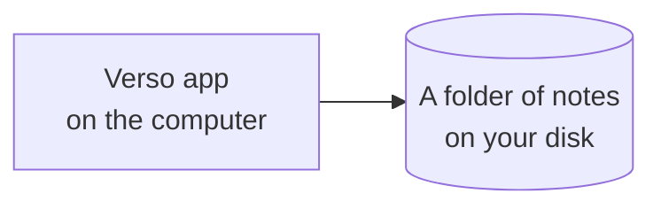
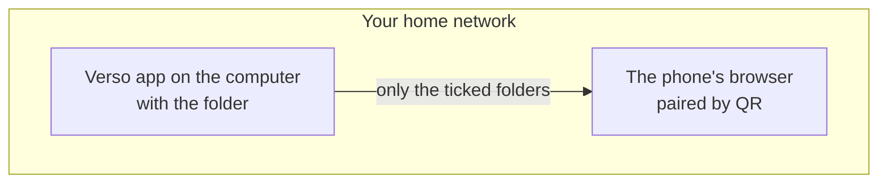
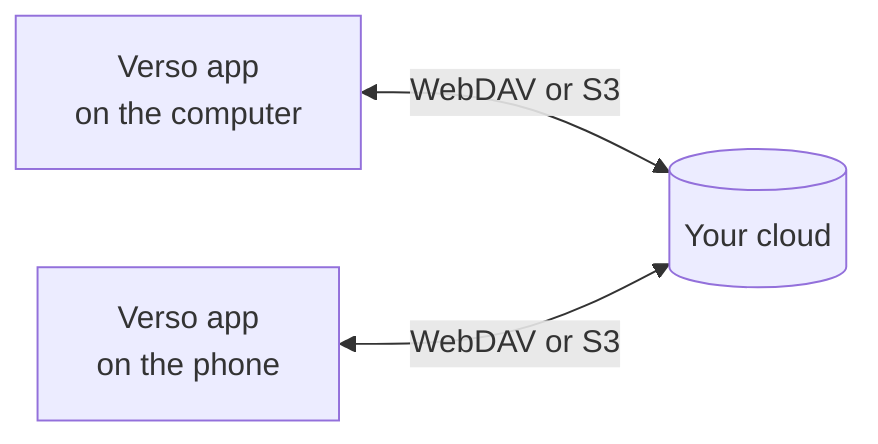
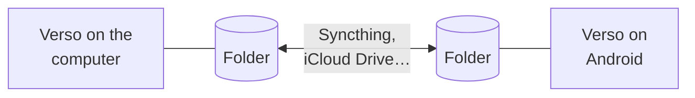
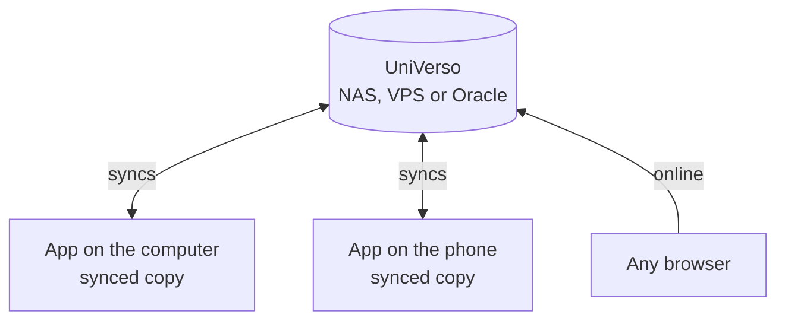
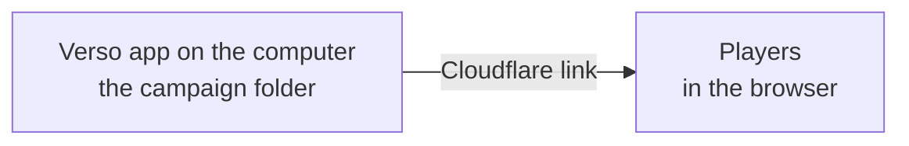
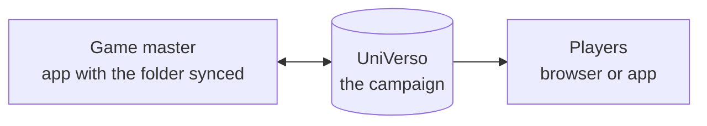
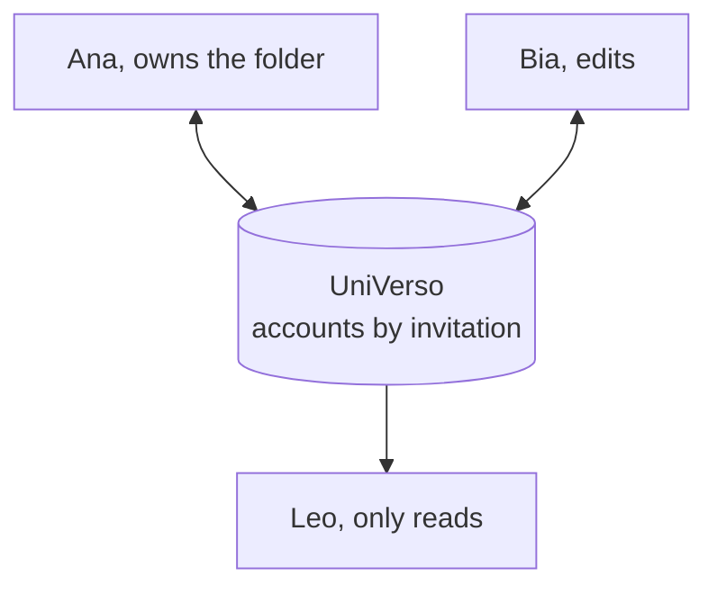
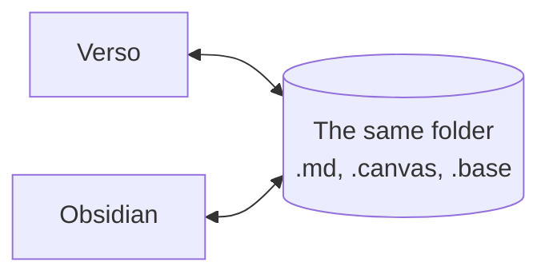

Verso is an app (on the computer, on Android and on the iPad or iPhone) that opens a folder of Markdown notes. **UniVerso** is the same Verso on a server of your own, for when the notes need to be on several devices or with other people. You do not need both: it depends on how you will use it. This note gathers the common ways, each with **who it is for**, **what to install and in what order**, **what works offline**, a drawing of where the notes live, and the lessons with the details.

> **Tip: Start with the simplest**
>
> Nothing here locks you into a scenario. A folder on your computer stays an ordinary folder: later, one click syncs it with a UniVerso (**Settings › Servers › Sync ‘your folder’**), and turning sync off leaves the files as they are, on both sides.

---

## Which one is yours

| You want… | See |
|---|---|
| To write on your computer only, or to open an Obsidian vault | [1. Only on my computer](#1-only-on-my-computer) |
| To see the computer's notes on your phone, at home, with no server to install | [2. Computer and phone, no server](#2-computer-and-phone-no-server) |
| The same notes on several devices, with no server | [3. Sync without a server](#3-sync-without-a-server) |
| Everything on every device, a copy that opens offline, and the browser from anywhere | [4. Your own UniVerso](#4-your-own-universo) |
| To play an RPG with friends over the internet | [5. Playing an RPG with friends](#5-playing-an-rpg-with-friends) |
| To share folders with your family or team, each with their role | [6. Family or team](#6-family-or-team) |
| To keep using Obsidian on the same folder | [7. Alongside Obsidian](#7-alongside-obsidian) |

The app comes from the download page, `versomd.com/en/download`: macOS, Windows and Linux, the Android APK and the iPad and iPhone `.ipa` (through AltStore, see [Verso on Phone and Tablet](/en/wiki/verso-on-phone-and-tablet/#the-app-for-ipad-and-iphone)).

---

## 1. Only on my computer

**Who it is for:** you write and organise alone, on one computer. Also anyone with an Obsidian vault who wants to try Verso.

1. Install the desktop app.
2. **Open folder** (`⌘ O`; on Windows and Linux, `Ctrl + O`): a new, empty folder, or an Obsidian vault as it is — nothing is converted or rewritten when it opens.
3. Done. No account, no server, nothing to set up.

**Offline:** everything. The internet is only for the app to look for updates.

More: [Files and Folders](/en/wiki/files-and-folders/), [Compatibility with Obsidian](/en/wiki/compatibility-with-obsidian/).

---

## 2. Computer and phone, no server

**Who it is for:** you want to read and write the computer's notes on your phone or tablet, **at home**, without setting up any server.

The desktop app itself becomes a server for your home network: the phone opens the folders you tick in its browser.

1. Install the desktop app and open your folder ([scenario 1](#1-only-on-my-computer)).
2. **Settings › Turn into a server**: tick the folders the phone may see (none comes ticked), leave **On my network** ticked under **Where to serve** and tap **Turn the server on**.
3. **Pair a phone**: point the phone's camera at the QR code (or open the address and type the eight-letter code). The browser warns that the certificate is not from a known authority: it is your computer's; accept it **only on a network you trust**.
4. On the computer, **Allow**. The phone opens the Verso window with the ticked folders.

**Offline:** the computer, everything. The phone **only while** it is on the same network and the desktop app is open and serving: it keeps no copy (the app's certificate does not let the folder be available offline).

**Want the notes on the phone away from home too?** The Android app (and the iPad and iPhone app) has a folder of its own, which opens offline; for it to hold the same notes as the computer, sync the two: with no server, through [scenario 3](#3-sync-without-a-server); with a server of your own, through [scenario 4](#4-your-own-universo). On Android the phone itself can serve too (**Settings › Turn into a server**, at a cost in battery).

More: [Verso on Phone and Tablet](/en/wiki/verso-on-phone-and-tablet/#pair-the-phone-with-your-computer).

---

## 3. Sync without a server

**Who it is for:** you want the same notes on more than one device, without installing a server. Two ways.

### With a cloud you already have (WebDAV or S3)

A Nextcloud (or another WebDAV server) or an S3 bucket (Amazon, MinIO, Cloudflare R2, Wasabi…) keeps a copy of the folder; each app compares its folder with the cloud and sends only what changed.

1. On the cloud, prepare the access: a Nextcloud **app password**, or an S3 key that reaches only one folder of one bucket.
2. In Verso, with the folder open: **Settings › Sync › Sync with… › WebDAV** (or **S3**), fill it in, tap **Check the cloud** and then **Sync this folder**.
3. On each other device, open a folder and connect it to the **same** cloud folder the same way. The first time nothing is deleted: what only one side has goes to the other.

**Offline:** everything, on each device; what changed crosses when the network is back (when the folder opens, on each change and every five minutes). A file changed on both sides is kept twice; nothing is lost.

**What a cloud folder does not have:** the browser, editing at the same time, sharing with other people, roles and the server's trash. Dropbox, OneDrive and Google Drive show as "coming soon".

More: [Syncing with a Cloud](/en/wiki/syncing-with-a-cloud/).

### With a program that syncs folders

Syncthing, iCloud Drive, OneDrive or Dropbox syncs the folder; Verso only opens it, as it would any other.

1. Install and set up the sync program, on both devices.
2. On the computer, **Open folder** and choose the synced folder.
3. On Android, in the folder switcher (the folder's name, at the top of the drawer), **Open another folder…** and choose the same folder; the first time Verso asks for **All files access**.

Verso never writes over a change that came from outside without showing the difference, and a file that iCloud or OneDrive left only in the cloud is never taken for deleted. Use **one syncer per folder**: Verso's or the other program, not both. Obsidian Sync belongs to Obsidian: Verso does not talk to it, it only sees the files change when Obsidian, open, syncs them.

More: [Verso on Phone and Tablet](/en/wiki/verso-on-phone-and-tablet/#the-android-app).

---

## 4. Your own UniVerso

**Who it is for:** you want the notes on **every** device, a copy in each app that opens offline, the browser from anywhere and the backup on a machine of yours.

UniVerso runs on a machine that stays on: a NAS at home, a rented server (VPS) or a free Oracle machine. The apps keep a **synced copy** of each folder; the browser works straight on the server.

1. **Install UniVerso** on the machine: the menu-driven guide on a free Oracle machine ([UniVerso on a Free Oracle Server](/en/wiki/universo-on-a-free-oracle-server/)), on a NAS or a VPS ([Installing the server on a NAS or a VPS](/en/wiki/installing-the-server-on-a-nas-or-a-vps/)) or the full step by step ([Installing Your UniVerso, Step by Step](/en/wiki/installing-your-universo-step-by-step/)).
2. **Create the first admin** through the setup link the server writes in its log, and sign in.
3. **HTTPS, if you want it** (Tailscale, a name with Caddy, or the Cloudflare link): plain HTTP works at home, but the browser's offline mode, notifications and passkeys exist only with HTTPS.
4. **On the computer**: **Settings › Servers**, **Connect** and, in the browser that opens, paste the code and **Approve this device**. Then, with your folder open, **Sync ‘your folder’** takes it to the server; or pick one of the server's folders, and **Choose where and download…** makes the copy.
5. **On Android, the iPad or the iPhone**: **Settings › Servers › Connect**; then pick one of the server's folders in the folder switcher and **Download and open** (on Android, **Inside the app** or **Phone/Documents**, where Obsidian sees it too).
6. **In any browser**: the server's address, your e-mail and your password.

**Offline:** each app's copy opens and takes changes; they go up when the network is back (a file changed on both sides becomes a conflict copy; nothing is lost). The browser needs the server, except for a folder you made **available offline** (**Settings › Offline**, with HTTPS). **Open on the server only, no copy** works only online.

> **Note: Whoever hosts sees the notes**
>
> There is no end-to-end encryption: the server reads the files to search and to edit together. On a machine of yours, whoever runs it is you.

More: [Verso on a Server](/en/wiki/verso-on-a-server/).

---

## 5. Playing an RPG with friends

**Who it is for:** you run a campaign and want the players at the [Table](/en/wiki/the-table/) — rolls, chat, notes revealed as you go. Two ways, with the same Table and the same invitations.

### From your computer, for a few hours

No server: the desktop app opens a **Cloudflare link** and the players come in through the browser. Like running Foundry on your computer: **it must stay on and awake** during the session.

1. **Settings › Turn into a server**: under **Where to serve**, tick **By an internet link (Cloudflare, testing mode)** and tap **Turn the server on** (the first time Verso downloads `cloudflared`, about 40 MB).
2. On the campaign folder's page, **Serve from this computer**; in the folder's menu, **Make this folder a table**.
3. On the table's card, **Invite players › Make link**, and send the link (valid 7 days, for one person).
4. The player opens the link, creates the account and comes in at the table's address.

The link lasts 12 hours (**Extend by 12 hours** keeps the same one) and changes each time it turns on, unless you use **your own address**, with a domain on Cloudflare.

### On a UniVerso, always on

The campaign lives on [your UniVerso](#4-your-own-universo): the table stays up with your computer off, and you run it from the app, with the folder synced.

1. A UniVerso with the campaign folder synced ([scenario 4](#4-your-own-universo)).
2. In the **Table** panel, **Make this folder a table**.
3. **Invite players › Make link**, and send it.

In both, each note starts **hidden** until you reveal it, and each player sees only their table's folder. A table that began on the computer goes to the UniVerso through **Move to another server**.

More: [A Table over the Internet](/en/wiki/a-table-over-the-internet/), [Running a Table](/en/wiki/running-a-table/).

---

## 6. Family or team

**Who it is for:** several people, each with their own notes, sharing some folders — the household's recipes, the team's documents.

1. A [UniVerso](#4-your-own-universo), installed by whoever will run it.
2. **Invitations**: in the admin console (`/admin`), the admin makes a single-use link (valid 7 days) for each person, who creates their account with it. Nobody signs up alone.
3. **Share**: the owner of a folder right-clicks it and chooses **Share…**, with the account's e-mail and the role — **reads** or **edits**. For the whole vault, **Share the whole folder…** in the root's menu.
4. Each person connects their apps (**Settings › Servers**) or uses the browser.

**The roles:** whoever **edits** writes, creates, renames and moves; **only the owner deletes**. Whoever **reads** does not receive the `[!secret]` blocks. For someone with no account, the owner makes a **read link** (read links start off; whoever runs the server turns them on). The admin does not enter a folder without giving themselves access, and that goes in the log.

Without a UniVerso, the desktop app also takes guests through the Cloudflare link ([A Table over the Internet](/en/wiki/a-table-over-the-internet/)), while the computer is on.

More: [Verso on a Server](/en/wiki/verso-on-a-server/#sharing-with-someone-else).

---

## 7. Alongside Obsidian

**Who it is for:** you already use Obsidian and do not want to choose.

1. Install Verso and **Open folder** on your vault (on a copy of it first, if you prefer).
2. Use both. Verso does not touch the `.obsidian` folder, rewrites nothing when it opens and, if Obsidian changed a note open in both, shows the difference instead of writing over it.

It holds in each scenario above: the copy of a UniVerso folder on the computer is an ordinary folder, which Obsidian opens; on Android, a copy in **Phone/Documents** is one Obsidian sees too. Obsidian plugins do not run in Verso.

More: [Compatibility with Obsidian](/en/wiki/compatibility-with-obsidian/).

---

Previous: [Sound and Music at the Table](/en/wiki/sound-and-music-at-the-table/) · Next: [Verso on Phone and Tablet](/en/wiki/verso-on-phone-and-tablet/) · [Home Page](/en/wiki/welcome-to-verso/) · Verso Tour
