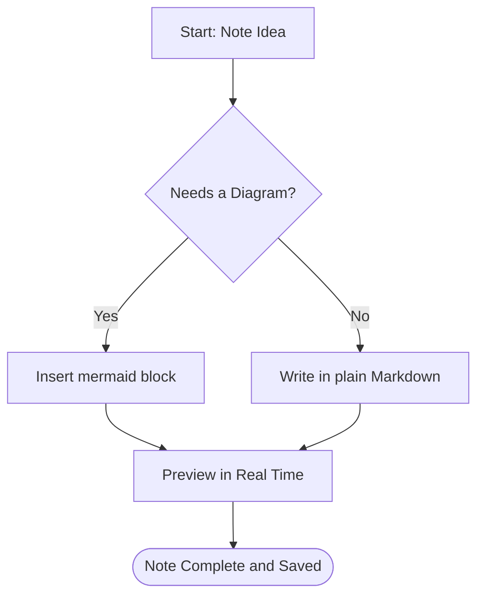
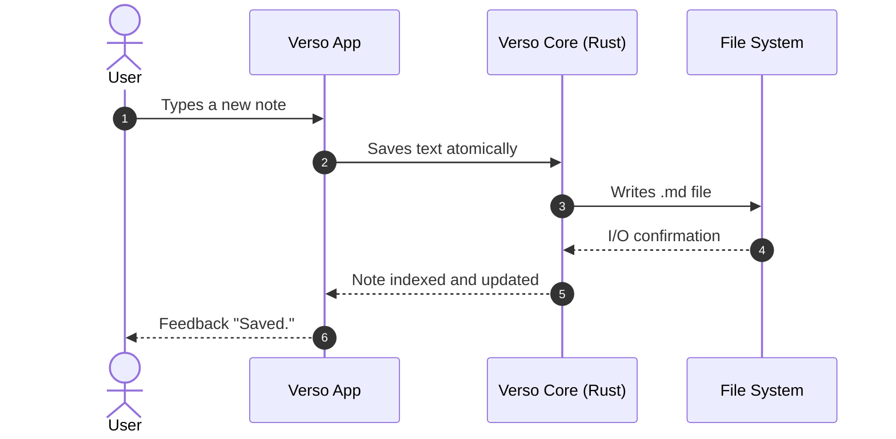
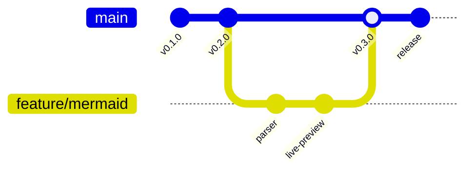
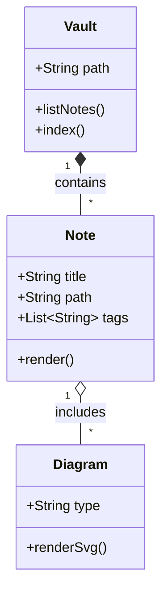
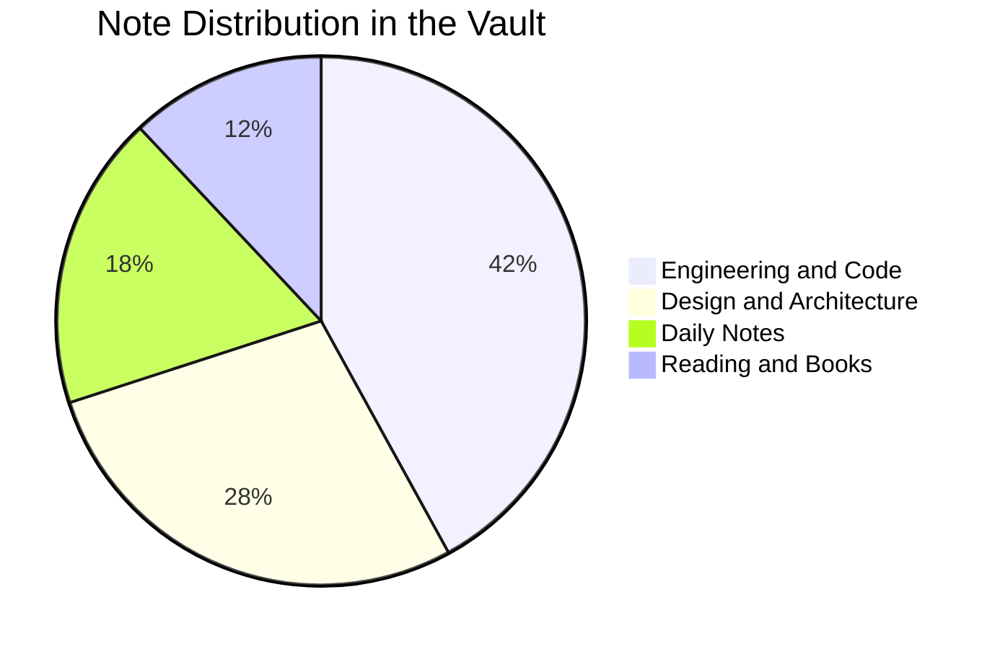

Verso has native, safe support for **[Mermaid](https://mermaid.js.org/)** diagrams in both **Reading** mode and **Edit** mode (Live Preview).

> **Tip**
>
> In **Edit** mode, the diagram is rendered automatically when your cursor is not on it. To edit the source code, just click the diagram or the `</>` button in the top right corner!

---

## 1. Flowchart

---

## 2. Sequence Diagram

---

## 3. Git Graph

---

## 4. Class Diagram

---

## 5. Pie Chart

---

Continue to [Board and Relations](/en/wiki/board-and-relations/) or go back to the [Home Page](/en/wiki/welcome-to-verso/).
