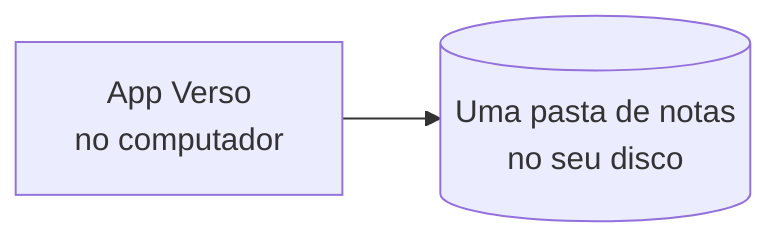
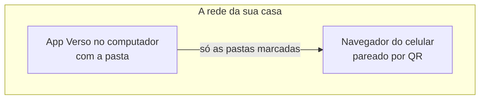
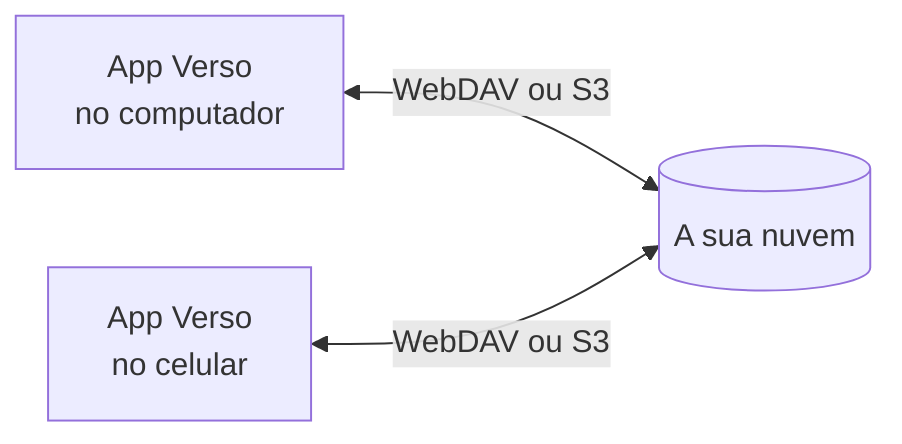
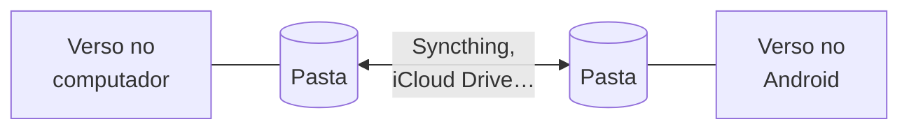
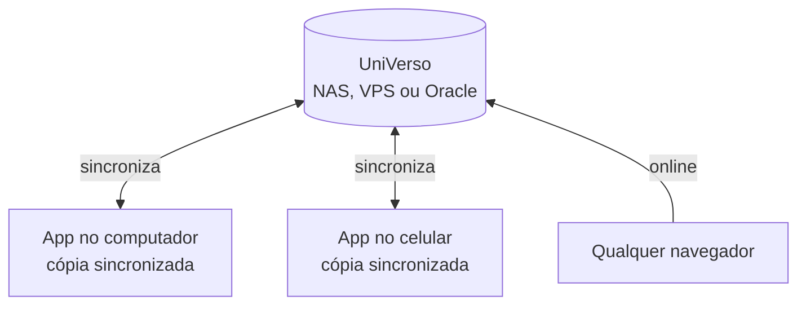
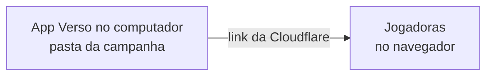
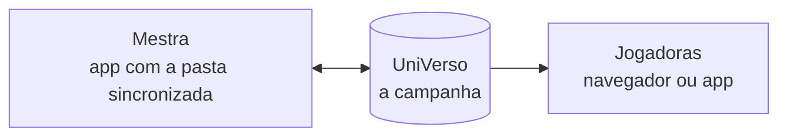
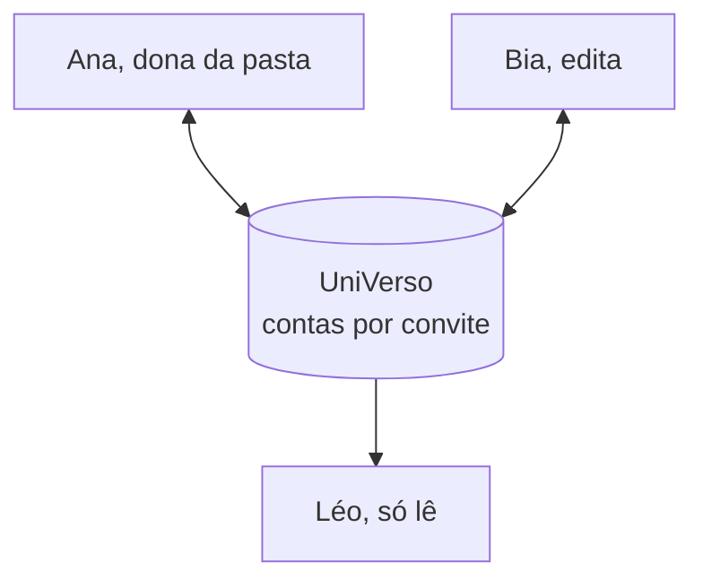
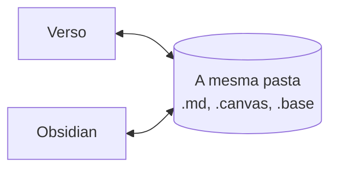

O Verso é um app (no computador, no Android e no iPad ou iPhone) que abre uma pasta de notas Markdown. O **UniVerso** é o mesmo Verso num servidor seu, para quando as notas precisam estar em vários aparelhos ou com outras pessoas. Você não precisa dos dois: depende de como vai usar. Esta nota junta os jeitos mais comuns, cada um com **para quem é**, **o que instalar e em que ordem**, **o que funciona sem internet**, um desenho de onde as notas moram e as lições com os detalhes.

> **Dica: Comece pelo mais simples**
>
> Nada aqui prende você a um cenário. Uma pasta do seu computador continua uma pasta comum: depois, um clique a sincroniza com um UniVerso (**Ajustes › Servidores › Sincronizar ‘sua pasta’**), e desligar a sincronização deixa os arquivos como estão, dos dois lados.

---

## Qual é o seu caso

| Você quer… | Veja |
|---|---|
| Escrever só no seu computador, ou abrir um cofre do Obsidian | [1. Só no meu computador](#1-só-no-meu-computador) |
| Ver as notas do computador no celular, em casa, sem instalar servidor | [2. Computador e celular, sem servidor](#2-computador-e-celular-sem-servidor) |
| As mesmas notas em vários aparelhos, sem servidor | [3. Sincronizar sem servidor](#3-sincronizar-sem-servidor) |
| Tudo em todos os aparelhos, com cópia sem internet, e o navegador de qualquer lugar | [4. O seu UniVerso](#4-o-seu-universo) |
| Jogar RPG com amigos pela internet | [5. Jogar RPG com amigos](#5-jogar-rpg-com-amigos) |
| Dividir pastas com a família ou a equipe, cada um com o seu papel | [6. Família ou equipe](#6-família-ou-equipe) |
| Continuar usando o Obsidian na mesma pasta | [7. Junto com o Obsidian](#7-junto-com-o-obsidian) |

O app vem da página de downloads, `versomd.com/baixar`: macOS, Windows e Linux, o APK do Android e o `.ipa` do iPad e do iPhone (pela AltStore, veja [Verso no Celular e no Tablet](/wiki/verso-no-celular-e-no-tablet/#o-app-para-ipad-e-iphone)).

---

## 1. Só no meu computador

**Para quem:** escreve e organiza sozinho, num computador. Também quem já tem um cofre do Obsidian e quer experimentar.

1. Instale o app do computador.
2. **Abrir pasta** (`⌘ O`; no Windows e no Linux, `Ctrl + O`): uma pasta nova e vazia, ou um cofre do Obsidian como está — nada é convertido nem reescrito ao abrir.
3. Pronto. Não há conta, servidor nem configuração.

**Sem internet:** tudo. A internet só serve para o app procurar atualizações.

Mais: [Arquivos e Pastas](/wiki/arquivos-e-pastas/), [Compatibilidade com o Obsidian](/wiki/compatibilidade-com-o-obsidian/).

---

## 2. Computador e celular, sem servidor

**Para quem:** quer ler e escrever as notas do computador no celular ou no tablet, **em casa**, sem montar servidor nenhum.

O próprio app do computador vira um servidor para a rede da sua casa: o celular abre as pastas que você marcar no navegador dele.

1. Instale o app do computador e abra a sua pasta ([cenário 1](#1-só-no-meu-computador)).
2. **Ajustes › Transformar em servidor**: marque as pastas que o celular pode ver (nenhuma vem marcada), deixe **Na minha rede** marcada em **Onde servir** e toque em **Ligar o servidor**.
3. **Parear um celular**: aponte a câmera do celular para o QR (ou abra o endereço e digite o código de oito letras). O navegador avisa que o certificado não é de uma autoridade conhecida: é o do seu computador; aceite **só numa rede em que você confia**.
4. No computador, **Permitir**. O celular abre a janela do Verso com as pastas marcadas.

**Sem internet:** o computador, tudo. O celular **só enquanto** está na mesma rede e o app do computador está aberto e servindo: ele não guarda cópia (o certificado do app não deixa a pasta ficar disponível sem rede).

**Quer as notas no celular mesmo fora de casa?** O app do Android (e o do iPad e do iPhone) tem a sua própria pasta, que abre sem internet; para ela ter as mesmas notas do computador, sincronize as duas: sem servidor, pelo [cenário 3](#3-sincronizar-sem-servidor); com um servidor seu, pelo [cenário 4](#4-o-seu-universo). No Android, o próprio celular também pode servir (**Ajustes › Transformar em servidor**, gastando bateria).

Mais: [Verso no Celular e no Tablet](/wiki/verso-no-celular-e-no-tablet/#parear-o-celular-com-o-seu-computador).

---

## 3. Sincronizar sem servidor

**Para quem:** quer as mesmas notas em mais de um aparelho, sem instalar servidor. Dois jeitos.

### Com uma nuvem que você já tem (WebDAV ou S3)

Um Nextcloud (ou outro WebDAV) ou um bucket S3 (Amazon, MinIO, Cloudflare R2, Wasabi…) guarda uma cópia da pasta; cada app compara a sua pasta com a nuvem e manda só o que mudou.

1. Na nuvem, prepare o acesso: uma **senha de aplicativo** do Nextcloud, ou uma chave de S3 que só alcança uma pasta de um bucket.
2. No Verso, com a pasta aberta: **Ajustes › Sincronizar › Sincronizar com… › WebDAV** (ou **S3**), preencha, toque em **Verificar a nuvem** e depois em **Sincronizar esta pasta**.
3. Em cada outro aparelho, abra uma pasta e ligue-a à **mesma** pasta da nuvem do mesmo jeito. Na primeira vez nada é apagado: o que só um lado tem vai para o outro.

**Sem internet:** tudo, em cada aparelho; o que mudou cruza quando a rede volta (ao abrir a pasta, a cada mudança e a cada cinco minutos). Um arquivo mudado nos dois lados fica duas vezes, nada se perde.

**O que não tem** numa pasta de nuvem: o navegador, a edição ao mesmo tempo, o compartilhamento com outras pessoas, os papéis e a lixeira do servidor. Dropbox, OneDrive e Google Drive aparecem como "em breve".

Mais: [Sincronizar com uma Nuvem](/wiki/sincronizar-com-uma-nuvem/).

### Com um programa que sincroniza pastas

O Syncthing, o iCloud Drive, o OneDrive ou o Dropbox sincronizam a pasta; o Verso só a abre, como abriria qualquer outra.

1. Instale e configure o programa de sincronização, nos dois aparelhos.
2. No computador, **Abrir pasta** e escolha a pasta sincronizada.
3. No Android, no seletor de pastas (o nome da pasta, no alto da gaveta), **Abrir outra pasta…** e escolha a mesma pasta; na primeira vez o Verso pede o **Acesso a todos os arquivos**.

O Verso nunca grava por cima de uma mudança que chegou de fora sem mostrar a diferença, e um arquivo que o iCloud ou o OneDrive deixaram só na nuvem nunca é tomado por apagado. Use **um sincronizador por pasta**: o do Verso ou o outro programa, não os dois. O Obsidian Sync é do Obsidian: o Verso não fala com ele, só vê os arquivos mudarem quando o Obsidian, aberto, os sincroniza.

Mais: [Verso no Celular e no Tablet](/wiki/verso-no-celular-e-no-tablet/#o-app-para-android).

---

## 4. O seu UniVerso

**Para quem:** quer as notas em **todos** os aparelhos, uma cópia em cada app que abre sem internet, o navegador de qualquer lugar e o backup numa máquina sua.

O UniVerso roda numa máquina que fica ligada: um NAS em casa, um servidor alugado (VPS) ou uma máquina grátis da Oracle. Os apps guardam uma **cópia sincronizada** de cada pasta; o navegador trabalha direto no servidor.

1. **Instale o UniVerso** na máquina: o roteiro com o menu numa máquina grátis da Oracle ([UniVerso num Servidor Grátis da Oracle](/wiki/universo-num-servidor-gratis-da-oracle/)), num NAS ou VPS ([Instalar o servidor num NAS ou VPS](/wiki/instalar-o-servidor-num-nas-ou-vps/)) ou o passo a passo completo ([Instalar o seu UniVerso, Passo a Passo](/wiki/instalar-o-seu-universo-passo-a-passo/)).
2. **Crie o primeiro admin** pelo link de configuração que o servidor escreve no log, e entre.
3. **HTTPS, se quiser** (o Tailscale, um nome com o Caddy ou o link da Cloudflare): o HTTP simples funciona em casa, mas o modo sem rede do navegador, as notificações e as passkeys só existem com HTTPS.
4. **No computador**: **Ajustes › Servidores**, **Conectar** e, no navegador que abre, cole o código e **Aprovar este aparelho**. Depois, com a sua pasta aberta, **Sincronizar ‘sua pasta’** a leva para o servidor; ou escolha uma pasta do servidor, e **Escolher onde e baixar…** faz a cópia.
5. **No Android, no iPad ou no iPhone**: **Ajustes › Servidores › Conectar**; depois escolha uma pasta do servidor no seletor e **Baixar e abrir** (no Android, **Dentro do app** ou **Celular/Documents**, onde o Obsidian também a vê).
6. **Em qualquer navegador**: o endereço do servidor, o seu e-mail e a sua senha.

**Sem internet:** a cópia de cada app abre e aceita mudanças; elas sobem quando a rede volta (um arquivo mudado nos dois lados vira uma cópia de conflito, nada se perde). O navegador precisa do servidor, a não ser numa pasta que você deixou **disponível sem rede** (**Ajustes › Sem rede**, com HTTPS). **Abrir só no servidor, sem cópia** funciona só com internet.

> **Nota: Quem hospeda vê as notas**
>
> Não há criptografia de ponta a ponta: o servidor lê os arquivos para buscar e para editar junto. Numa máquina sua, quem a administra é você.

Mais: [Verso num Servidor](/wiki/verso-num-servidor/).

---

## 5. Jogar RPG com amigos

**Para quem:** mestra uma campanha e quer as jogadoras na [Mesa](/wiki/a-mesa/) — rolagens, chat, notas liberadas aos poucos. Dois jeitos, com a mesma Mesa e os mesmos convites.

### Do seu computador, por algumas horas

Sem servidor: o app do computador abre um **link da Cloudflare** e as jogadoras entram pelo navegador. Como rodar o Foundry no seu computador: **ele precisa ficar ligado e acordado** durante a sessão.

1. **Ajustes › Transformar em servidor**: em **Onde servir**, marque **Por um link na internet (Cloudflare, modo de teste)** e toque em **Ligar o servidor** (na primeira vez o Verso baixa o `cloudflared`, cerca de 40 MB).
2. Na página da pasta da campanha, **Servir deste computador**; no menu da pasta, **Tornar esta pasta uma mesa**.
3. No cartão da mesa, **Convidar jogadores › Gerar link**, e mande o link (vale 7 dias, para uma pessoa).
4. A jogadora abre o link, cria a conta e entra pelo endereço da mesa.

O link dura 12 horas (**Prorrogar por 12 horas** mantém o mesmo) e muda a cada vez que liga, a não ser que você use **o seu endereço**, com um domínio na Cloudflare.

### Num UniVerso, sempre no ar

A campanha mora no [seu UniVerso](#4-o-seu-universo): a mesa fica no ar com o seu computador desligado, e você mestra do app, com a pasta sincronizada.

1. Um UniVerso com a pasta da campanha sincronizada ([cenário 4](#4-o-seu-universo)).
2. No painel **Mesa**, **Tornar esta pasta uma mesa**.
3. **Convidar jogadores › Gerar link**, e mande.

Nos dois, cada nota começa **oculta** até você liberar, e cada jogadora vê só a pasta da mesa dela. Uma mesa que começou no computador vai para o UniVerso por **Mudar de servidor**.

Mais: [Mesa pela Internet](/wiki/mesa-pela-internet/), [Rodando uma Mesa](/wiki/rodando-uma-mesa/).

---

## 6. Família ou equipe

**Para quem:** várias pessoas, cada uma com as suas notas, dividindo algumas pastas — a receita da casa, os documentos da equipe.

1. Um [UniVerso](#4-o-seu-universo), instalado por quem vai administrá-lo.
2. **Convites**: no console de administração (`/admin`), o admin gera um link de uso único (vale 7 dias) para cada pessoa, que cria a conta com ele. Ninguém se cadastra sozinho.
3. **Compartilhar**: a dona de uma pasta clica com o botão direito nela e escolhe **Compartilhar…**, com o e-mail da conta e o papel — **lê** ou **edita**. Para o cofre todo, **Compartilhar a pasta toda…** no menu da raiz.
4. Cada pessoa conecta os apps dela (**Ajustes › Servidores**) ou usa o navegador.

**Os papéis:** quem **edita** escreve, cria, renomeia e move; **só a dona apaga**. Quem **lê** não recebe os blocos `[!secret]`. Para quem não tem conta, a dona faz um **link de leitura** (os links começam desligados; quem administra os liga). O admin não entra numa pasta sem dar acesso a si mesmo, e isso fica no registro.

Sem UniVerso, o app do computador também recebe convidados pelo link da Cloudflare ([Mesa pela Internet](/wiki/mesa-pela-internet/)), enquanto o computador está ligado.

Mais: [Verso num Servidor](/wiki/verso-num-servidor/#compartilhar-com-outra-pessoa).

---

## 7. Junto com o Obsidian

**Para quem:** já usa o Obsidian e não quer escolher.

1. Instale o Verso e **Abrir pasta** no seu cofre (se preferir, numa cópia dele primeiro).
2. Use os dois. O Verso não mexe na pasta `.obsidian`, não reescreve nada ao abrir e, se o Obsidian mudou uma nota aberta nos dois, mostra a diferença em vez de gravar por cima.

Vale em cada cenário acima: a cópia de uma pasta do UniVerso no computador é uma pasta comum, que o Obsidian abre; no Android, uma cópia em **Celular/Documents** o Obsidian também vê. Plugins do Obsidian não rodam no Verso.

Mais: [Compatibilidade com o Obsidian](/wiki/compatibilidade-com-o-obsidian/).

---

Anterior: [Som e Música na Mesa](/wiki/som-e-musica-na-mesa/) · Próxima: [Verso no Celular e no Tablet](/wiki/verso-no-celular-e-no-tablet/) · [Página Inicial](/wiki/bem-vindo-ao-verso/) · Tour do Verso
