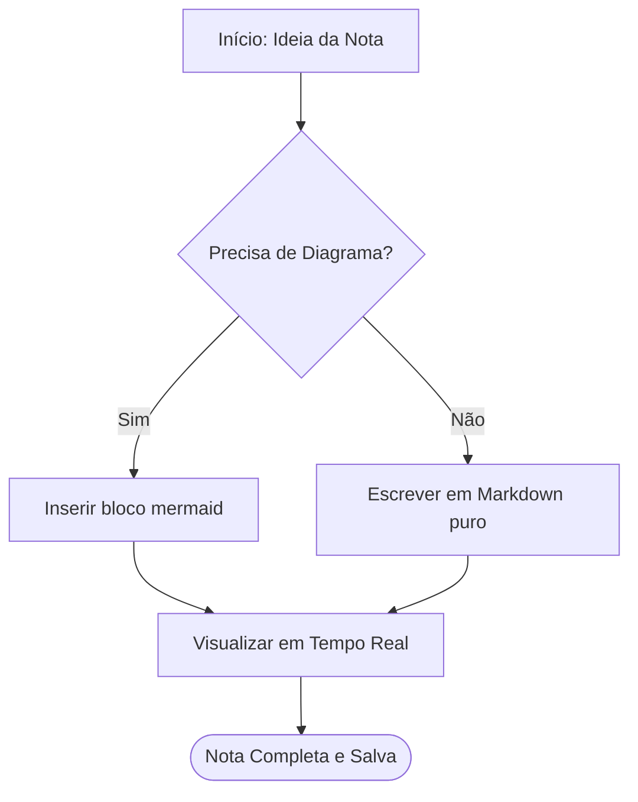
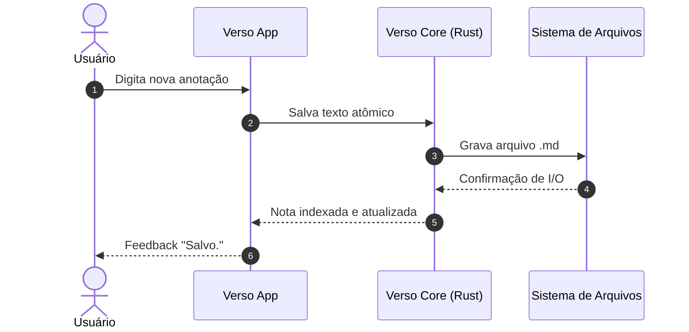
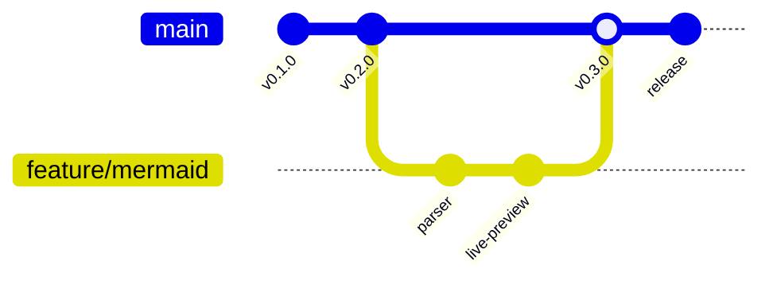
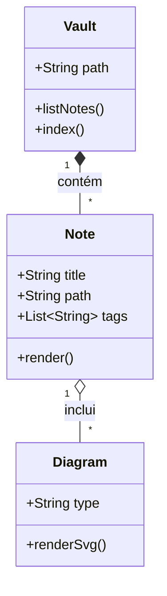
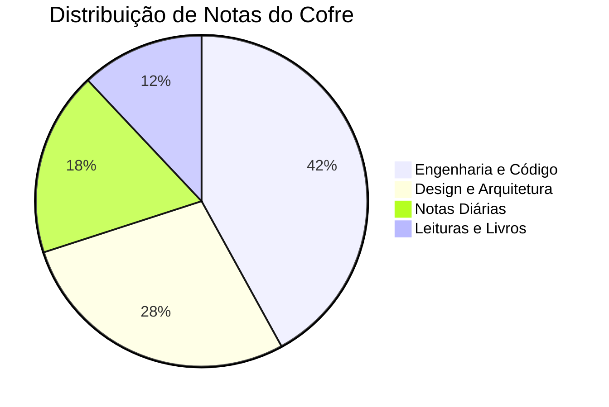

O Verso oferece suporte nativo e seguro a diagramas **[Mermaid](https://mermaid.js.org/)** tanto no modo **Leitura** quanto no modo **Editar (Live Preview)**.

> **Dica**
>
> No modo **Editar**, o diagrama é renderizado automaticamente quando você não está com o cursor nele. Para editar o código-fonte, basta clicar no diagrama ou no botão `</>` no canto superior direito!

---

## 1. Fluxograma (Flowchart)

---

## 2. Diagrama de Sequência (Sequence Diagram)

---

## 3. Fluxo de Git (Git Graph)

---

## 4. Diagrama de Classes (Class Diagram)

---

## 5. Gráfico de Pizza (Pie Chart)

---

Siga para [Board e Relações](/wiki/board-e-relacoes/) ou volte para a [Página Inicial](/wiki/bem-vindo-ao-verso/).
